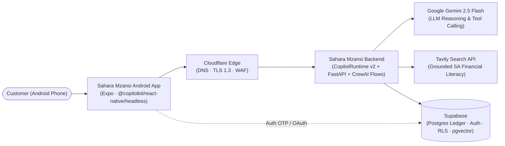

# High-Level Design: [System / Feature Name]

**Version:** 1.0
**Author(s):** [Names]
**Status:** `Draft` | `In Review` | `Approved`
**Date:** YYYY-MM-DD
**Related ADRs:** [ADR-NNN links]
**Related TDDs:** [TDD links]

**Audience:** Product owners, solution architects, engineering leads, stakeholders
**FinOps Ceiling:** `<= $20 / month`

---

## 1. Scope and Objectives

**In scope:**
- [System/capability 1]
- [System/capability 2]

**Out of scope:**
- [Explicitly excluded — e.g., Web channel, iOS builds, real licensed banking rails]

**Business objectives:**
- [Objective tied to a measurable user or financial literacy outcome]
- [Guardrail / compliance objective]

## 2. Architecture Principles Applied

| Principle | Application to This System |
|---|---|
| Strict 4-tier separation | Channel (Android) → Experience (AG-UI + CrewAI) → Process (FastAPI) → System (Supabase + Adapters) |
| Two-phase HITL safety | Agents stage proposals (`PENDING_APPROVAL`); human biometric approval executes writes |
| Integer-cent accounting | All monetary values stored and computed as `BIGINT` cents |
| Grounded intelligence | Financial literacy and rates backed by `pgvector` + domain-restricted Tavily search |
| Idempotent & audited | Every mutation requires `X-Idempotency-Key` and appends to `audit_events` |
| Hard FinOps cap | Scales to zero within free/near-free tiers (`<= $20/month` total) |

## 3. System Context (C4 Level 1)

## 4. Container Architecture (C4 Level 2)

| Container | Technology | Layer | Responsibility |
|---|---|---|---|
| Android App | React Native (Expo, TypeScript) | Channel | Onboarding, Dashboard, Copilot UI, Native GenUI Catalogue, `BiometricPrompt` gate |
| Copilot Runtime | Node 22 (`@copilotkit/runtime`) | Experience | Terminates AG-UI stream, verifies JWT, rate-limits, bridges to CrewAI |
| Agent & Process API | Python 3.12 (`FastAPI` + `CrewAI`) | Experience + Process | Runs `Flow[CopilotKitState]` (*Jabu*, *Kagiso*, *Thabo*) + `/v1/*` domain & ledger endpoints |
| System of Record | Supabase (`Postgres 15+` + `Auth`) | System | Double-entry ledger, RLS, `pgvector` literacy store, append-only `audit_events` |

## 5. Security & Agentic Guardrails

| Control | Mechanism |
|---|---|
| Channel authentication | Supabase Auth (OAuth 2.0 / OTP) stored in Android Keystore (`expo-secure-store`) |
| Data in transit / at rest | TLS 1.3 minimum in transit; AES-256 at rest |
| Consequential actions | Two-phase HITL gate + Android `BiometricPrompt` verification |
| Audit trail | Append-only `audit_events` table (`UPDATE`/`DELETE` revoked) |
| PCI scope | Out of scope — virtual cards store tokenized `last4` display metadata only |

## 6. FinOps Budget Breakdown (`<= $20/Month`)

| Component | Tier | Estimated Monthly Cost |
|---|---|---|
| Mobile Build & Distribution | Expo EAS Free + Firebase App Distribution | `$0.00` |
| Backend Compute | Google Cloud Run (scale-to-zero free tier) | `$0.00` |
| Database & Auth | Supabase Free Tier | `$0.00` |
| LLM & Search | Gemini 2.5 Flash (`$10` cap) + Tavily Free Tier | `$0.00 – $8.00` |
| Edge & Domain | Cloudflare Free + Custom Domain | `~$1.00` |

## 7. Key Architecture Decisions

| ADR | Decision | Status |
|---|---|---|
| ADR-NNN | [Short description] | Accepted |

## 8. Risks and Mitigations

| Risk | Likelihood | Impact | Mitigation |
|---|---|---|---|
| [Risk description] | High/Med/Low | High/Med/Low | [Mitigation strategy] |
