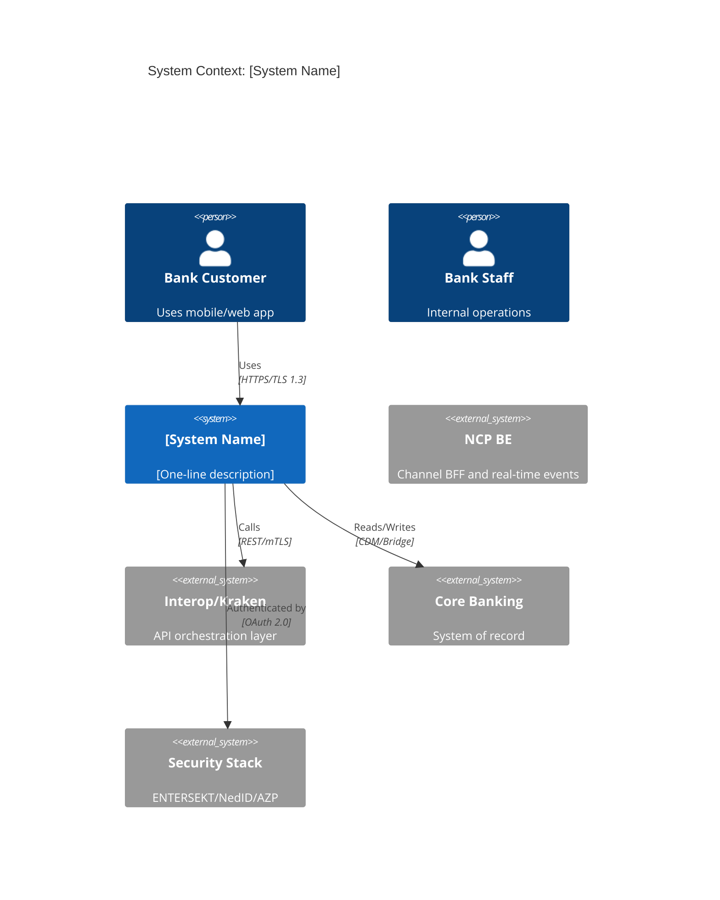
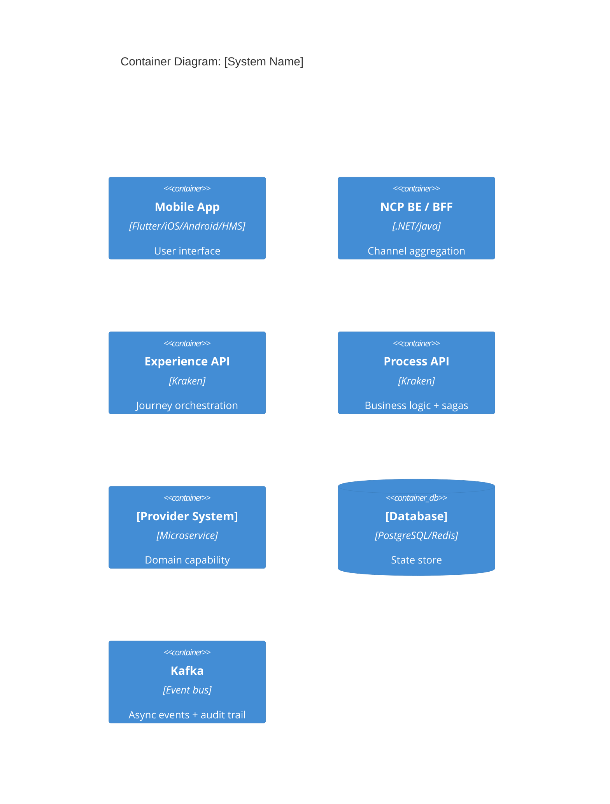

# High-Level Design: [System / Product / Programme Name]

**Version:** 1.0
**Author(s):** [Names]
**Status:** `Draft` | `In Review` | `Approved`
**Date:** YYYY-MM-DD
**Programme/Epic:** [link]
**Related ADRs:** [ADR-NNN links]
**Related TDDs:** [TDD links]

**Audience:** Product owners, programme managers, solution architects, senior stakeholders
**Classification:** Internal

---

## 1. Scope and Objectives

**In scope:**
- [System/capability 1]
- [System/capability 2]

**Out of scope:**
- [Explicitly excluded — prevents misaligned expectations]

**Business objectives:**
- [Objective tied to a measurable outcome]
- [Regulatory or risk objective]

## 2. Architecture Principles Applied

| Principle | Application to This System |
|---|---|
| API-first | All capabilities exposed as versioned OpenAPI 3.1 contracts before implementation |
| Event-driven for auditability | All state changes emit immutable Kafka events |
| Zero-trust security | No implicit trust between services; mTLS + OAuth 2.0 on every hop |
| CDM everywhere | All inter-service data uses Canonical Data Model types |
| Experience/Process/System separation | [How this system respects layer boundaries] |
| Fail-safe defaults | Circuit breakers default to safe state (not fail-open) |

## 3. System Context (C4 Level 1)



## 4. Container Architecture (C4 Level 2)



## 5. Integration Landscape

| Integration | Direction | Protocol | Pattern | Layer |
|---|---|---|---|---|
| [System A] | Inbound | REST / OAuth 2.0 | Sync request-response | Experience |
| [System B] | Outbound | Kafka | Async choreography | Process |
| [System C] | Outbound | SOAP/XML via Bridge | Sync + retry | System |

## 6. Data Flow Overview

```
[Source] → [Processing step] → [Destination]

1. Customer submits request via Mobile → NCP SDK → NCP BE
2. NCP BE aggregates from Experience API → Redis Cache + Process API
3. Process API executes saga → Provider System (CDM) → Core Banking (Bridge)
4. Events emitted to Kafka → EDP (audit, analytics, NBA)
5. AJO receives event → delivers personalised response via Notification Center
```

**Data classification:**
| Data Type | Classification | Handling Requirement |
|---|---|---|
| [Account balance] | Confidential | Encrypted at rest; no logging |
| [Customer PII] | Restricted | PoPIA consent required; ZA residency |
| [Transaction reference] | Internal | Standard encryption |

## 7. Security Architecture

| Control | Mechanism |
|---|---|
| Channel authentication | OAuth 2.0 / PKCE via NedID |
| Service-to-service | mTLS with rotate-able certificates |
| Data in transit | TLS 1.3 minimum |
| Data at rest | AES-256; HSM-managed keys |
| High-risk transactions | ENTERSEKT OOBV step-up |
| Audit trail | Immutable Kafka events → ELK/GRFS |
| PCI scope | [Describe card data boundary and controls] |

## 8. NFR Summary

| Attribute | Requirement |
|---|---|
| Availability | 99.95% (< 4.4h downtime/year) |
| Latency | p99 < [X]ms end-to-end |
| Throughput | [X] TPS sustained / [Y] TPS peak |
| RTO | [X] hours |
| RPO | [X] hours |
| Scale | Horizontal; [N] instances under peak |

## 9. Technology Stack

| Component | Technology | Rationale |
|---|---|---|
| Mobile | Flutter (iOS/Android/HMS) | Tri-platform, hardware biometrics |
| API Gateway | Azure API Gateway / Kraken | [Rationale per ADR-NNN] |
| Event streaming | Apache Kafka | Durable, replayable, CDM-enforced |
| Database | [PostgreSQL / Redis / etc.] | [Rationale] |
| Observability | OpenTelemetry + [APM tool] | Standard RED metrics |

## 10. Key Architecture Decisions

| ADR | Decision | Status |
|---|---|---|
| ADR-NNN | [Short description] | Accepted |

## 11. Risks and Constraints

| Risk | Likelihood | Impact | Mitigation |
|---|---|---|---|
| [Risk description] | High/Med/Low | High/Med/Low | [Mitigation strategy] |

## 12. Target State vs Current State

| Dimension | Current State | Target State | Gap |
|---|---|---|---|
| Architecture | [Current] | [Target] | [What must change] |
| Technology | [Current] | [Target] | [Migration needed] |
| Capability | [Current] | [Target] | [Features to build] |

## 13. Transition Phases

| Phase | Scope | Duration | Exit Criteria |
|---|---|---|---|
| Phase 1 | [MVP scope] | [Sprints/months] | [Measurable exit criterion] |
| Phase 2 | [Full scope] | [Duration] | [Criterion] |
