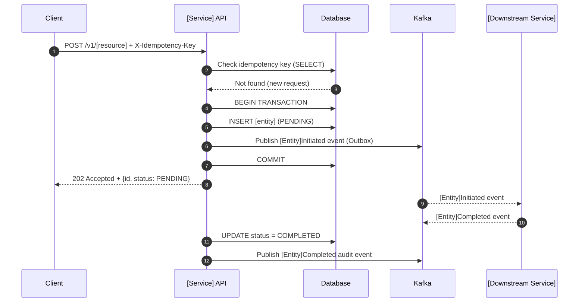
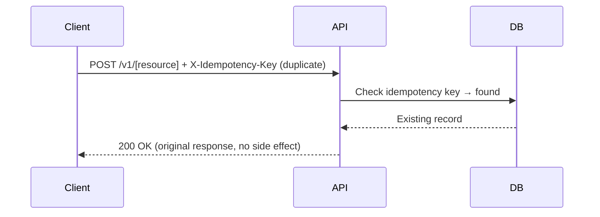
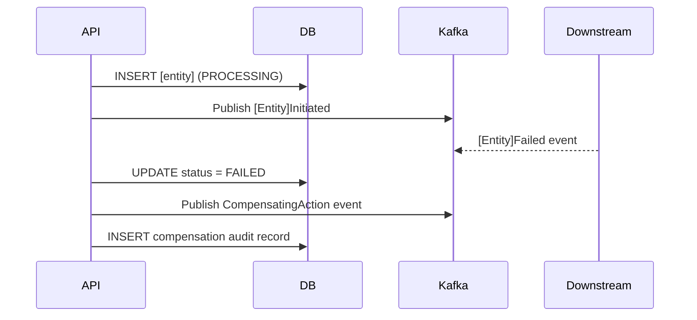

# Low-Level Design: [Component / Service Name]

**Version:** 1.0
**Author(s):** [Names]
**Reviewers:** [Names]
**Status:** `Draft` | `In Review` | `Approved`
**Date:** YYYY-MM-DD
**Parent TDD/HLD:** [links]
**Related ADR(s):** [ADR-NNN links]

**Audience:** Developers, QA engineers, security reviewers
**Layer:** `Experience` | `Process` | `System`

---

## 1. Purpose and Scope

What this component does and what it does NOT do. Single-sentence responsibility statement.

## 2. Module / Package Structure

```
src/
  [domain]/
    api/             # Controllers / handlers — thin, no business logic
    application/     # Use cases / application services
    domain/          # Domain model, entities, value objects, domain events
    infrastructure/  # Adapters: DB, Kafka, external APIs, CDM mappers
    config/          # Spring/Quarkus/DI configuration
  
test/
  unit/
  integration/
  contract/
```

**Hexagonal architecture enforcement:**
- Domain layer has zero infrastructure dependencies
- Application layer depends only on domain
- Infrastructure adapters implement domain ports (interfaces)

## 3. Class / Interface Design

```kotlin
// Example: domain entity
data class [Entity](
    val id: EntityId,
    val status: [Entity]Status,
    val createdAt: Instant,
    // ... CDM-aligned field names
) {
    fun [businessMethod](): [Entity] {
        // domain logic; pure function; no side effects
    }
}

// Example: application service / use case
interface [UseCase]Port {
    fun execute(command: [Command]): [Result]
}

// Example: outbound port (infrastructure interface)
interface [Entity]Repository {
    fun findById(id: EntityId): [Entity]?
    fun save(entity: [Entity]): [Entity]
}
```

## 4. API Specification

Full specification: `.github/templates/api-contract-template.yaml` (populated for this service)
Reference: [link to this service's OpenAPI spec in repo]

**Key endpoint contracts (summary):**

| Method | Path | Request | Response | Auth Scope |
|---|---|---|---|---|
| POST | /v1/[resource] | `Create[Resource]Request` | 202 + `[Resource]` | `[scope]` |
| GET | /v1/[resource]/{id} | — | 200 + `[Resource]` | `[scope]` |

**Idempotency:** POST and PATCH endpoints require `X-Idempotency-Key: UUID` header.

## 5. Database Design

### Schema

```sql
CREATE TABLE [table_name] (
    id          UUID PRIMARY KEY DEFAULT gen_random_uuid(),
    -- CDM reference field
    cdm_ref     VARCHAR(100)     NOT NULL,
    status      VARCHAR(50)      NOT NULL,
    payload     JSONB            NOT NULL,
    -- Audit fields (immutable after insert)
    created_at  TIMESTAMP        NOT NULL DEFAULT NOW(),
    updated_at  TIMESTAMP        NOT NULL DEFAULT NOW(),
    -- Idempotency
    idempotency_key UUID         UNIQUE
);

-- Indexes
CREATE INDEX idx_[table]_status    ON [table_name](status);
CREATE INDEX idx_[table]_created   ON [table_name](created_at DESC);
```

**Partitioning strategy:** [None / Range by created_at (monthly) / Hash by user_id]
**Retention policy:** [N months live; archive to cold storage; purge after N years per PoPIA]
**Sensitive fields:** [List fields requiring field-level encryption]

### Query Patterns and N+1 Prevention

| Query | Pattern | Index Used |
|---|---|---|
| Fetch by ID | `SELECT * WHERE id = $1` | Primary key |
| List by user | `SELECT * WHERE user_id = $1 ORDER BY created_at DESC LIMIT $2` | `idx_user_created` |

**Connection pool:** HikariCP; max [N] connections per instance; idle timeout [N]s

## 6. Sequence Diagrams

### Happy Path



### Error: Duplicate Request (Idempotency)



### Error: Downstream Failure (Compensation)



## 7. Error Handling

| Error Scenario | Caught At | HTTP Status | Error Code | Recovery Strategy |
|---|---|---|---|---|
| Validation failure | API layer | 400 | `INVALID_REQUEST` | Client retry with fix |
| Idempotency collision | API layer | 200 | — | Return original response |
| Business rule violation | Application layer | 422 | `[DOMAIN_CODE]` | No retry; user action needed |
| Downstream timeout | Infrastructure | 504 | `UPSTREAM_TIMEOUT` | Retry with backoff (Resilience4j) |
| Downstream 5xx | Infrastructure | 502 | `UPSTREAM_ERROR` | Circuit breaker; DLQ |
| Database constraint | Infrastructure | 500 | `INTERNAL_ERROR` | Alert; compensate |

**Retry policy (Resilience4j):**
```yaml
resilience4j:
  retry:
    instances:
      [downstream-service]:
        maxAttempts: 3
        waitDuration: 200ms
        exponentialBackoffMultiplier: 2
        retryExceptions:
          - java.io.IOException
          - java.util.concurrent.TimeoutException
  circuitbreaker:
    instances:
      [downstream-service]:
        slidingWindowSize: 10
        failureRateThreshold: 50
        waitDurationInOpenState: 30s
```

## 8. Configuration

| Parameter | Default | Override via | Description |
|---|---|---|---|
| `[service].timeout-ms` | 5000 | Env var / secrets manager | Downstream call timeout |
| `[service].retry-max` | 3 | Env var | Max retry attempts |
| `kafka.topic.[event]` | `[default]` | Env var | Kafka topic name |

No credentials or secrets in configuration files — reference secrets manager:
```yaml
datasource:
  password: ${SECRETS_MANAGER_REF:db-password}
```

## 9. Caching Strategy

| Cache | Technology | TTL | Invalidation | Notes |
|---|---|---|---|---|
| [Reference data] | Redis | 1 hour | On-write event | CDM reference tables |
| [Session state] | Redis | 15 min | On logout/expiry | OAuth token metadata |
| [Feature flags] | In-process + Redis | 5 min | Push update | Local fast-path + remote sync |

## 10. Security Controls

- **Input validation:** All request DTOs validated via Bean Validation / Zod annotations before reaching the application layer
- **SQL injection:** Parameterised queries only; no string concatenation in queries
- **Output encoding:** Response serialiser configured for HTML encoding; no raw string concatenation in JSON
- **Sensitive fields in logs:** `@JsonIgnore` / log masking on: accountNumber, nationalId, tokenisedCard, sessionToken
- **Secrets:** Zero secrets in code. Inject via environment variables referencing secrets manager.

## 11. Observability

**Log events (key structured fields):**
```json
{
  "timestamp": "ISO8601",
  "level": "INFO|WARN|ERROR",
  "service": "[service-name]",
  "correlationId": "uuid",
  "traceId": "uuid",
  "spanId": "uuid",
  "operation": "[operation-name]",
  "durationMs": 45,
  "outcome": "success|failure",
  "message": "..."
}
```

**Metrics exposed (Prometheus):**
- `[service]_requests_total{method, path, status}` — request counter
- `[service]_request_duration_seconds{method, path}` — latency histogram
- `[service]_kafka_lag{topic, consumer_group}` — consumer lag gauge
- `[service]_circuit_breaker_state{name}` — circuit breaker gauge

**Alert conditions:**
- Error rate > 1% for 2 minutes → P2 alert
- p99 latency > [X]ms for 5 minutes → P2 alert
- Circuit breaker OPEN → P1 alert

## 12. Migration Plan (if replacing existing component)

| Phase | Action | Rollback |
|---|---|---|
| Phase 1 | Deploy new service with feature flag off | Remove deployment |
| Phase 2 | Enable for [N]% traffic (canary) | Set flag to 0% |
| Phase 3 | 100% traffic; old service in passive monitoring mode | Re-route traffic |
| Phase 4 | Decommission old service | N/A (permanent) |

**Data migration:** [Schema migration scripts in `db/migrations/`; backward-compatible; tested with rollback script]
