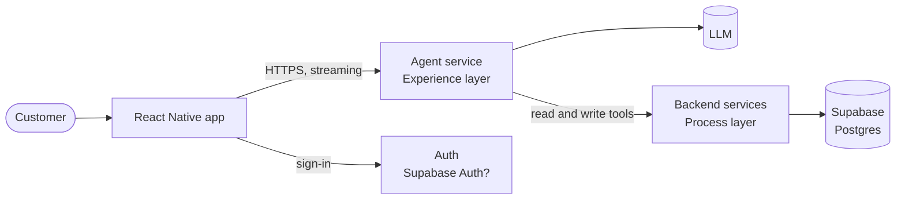

# Agentic mobile app: architecture workshop notes

Status: working draft. Captures what is decided, what follows from it, and what we still need to settle together. It is the input for the HLD (`.github/templates/hld-template.md`) and for the ADRs.

## 1. Decisions so far

| # | Decision | Source |
|---|---|---|
| D1 | We build an agentic app. An architect has given the go-ahead after the web demo. | User, 2026-10-27 |
| D2 | The channel is a **React Native mobile app**, not web. | User |
| D3 | **The agent can read and write.** The user journey mirrors the web demo (section 3). This replaces the earlier "read-only first release" decision. | User, update |
| D4 | The POC runs in **Docker on the MacBook**. The only planned spend is a domain name. | User |
| D5 | **Supabase is the database.** Other technology choices are discovered as we go. | User, update |
| D6 | We design the end-to-end architecture in documentation before implementing. | User |
| D7 | **The app is a standalone React Native app.** The brownfield approach (React Native embedded in a native Swift host) is dropped, and its scaffold and plan were removed. | User, update |

## 2. What these decisions imply

**Layering.** The architecture standards place "Agentic" in the Experience layer. The agent presents data and asks for actions. It holds no business rules. With writes in scope (D3), every state change must be a tool call that goes through a validated path, never a direct database write from the model. Where that path lives is open question Q8.

**Writes bring new requirements.** From the standards and the demo:
- Every state-changing endpoint takes an idempotency key (`X-Idempotency-Key`), so a retried request or a model that repeats a tool call cannot place two orders.
- Money-affecting actions need explicit user approval. The demo did this with `placeOrder` and an approval card that paused the agent run. The mobile version needs the same pause, as a native approval screen. A model must never be able to approve on the user's behalf.
- Errors follow RFC 9457 Problem Details, so the agent can explain a failure instead of guessing.
- Multi-step writes (checkout: address, delivery, payment, order) need a defined failure story. If a step fails halfway, what is undone? Compensation is declared in the design before implementation.
- Audit: who asked, what the agent proposed, what the user approved, what was executed. Needed even in a demo to make the approval story credible.

**Supabase (D5).** A new external dependency needs an ADR (architecture standards). Things to settle:
- **Hosted or self-hosted.** Supabase's hosted service is cloud and may cost money beyond a free tier, which conflicts with "only spend on a domain" (D4). The alternative is to self-host Supabase in Docker on the MacBook, which is heavier to run. Q9.
- **Authentication.** Supabase includes an auth service. Using it would replace the demo's fake login and give us real user identity, which row-level security can use. Q10.
- **Access rules.** Supabase exposes the database over an API, so row-level security (RLS) is the main defence. Tables with user data must have it enabled and tested.
- **Secrets.** The service-role key bypasses RLS. It must live only in the backend and never in the mobile app. The app uses the public anon key and the user's session token only.
- **Fit with the layers.** Supabase can sit as the System layer's system of record, behind our own services. Whether the app or agent may talk to Supabase directly is Q8.

**Generative UI on mobile.** The web demo rendered React components inside a CopilotKit chat. That does not carry over to React Native. The likely pattern is a **catalogue of native RN components** (product card, cart summary, order summary, approval card). The agent returns a component name plus typed data, and the app renders it. The catalogue is a contract, so it needs versioning. Q3.

**LLM without a hosting budget (D4).** "Only spend on a domain" rules out a paid hosted model API. That leaves two options, and I need you to pick one (Q1):
- **A local open model** run on the MacBook. Docker Desktop on macOS may not give containers GPU access, so a model in a container could be very slow. Running the model natively on the host and calling it from the containers may be needed. To verify before we commit. A smaller model also tends to be weaker at reliable tool calling, which matters more now that the agent writes.
- **The offline rule-based agent** from the demo (`frontend/web/src/lib/demo-adapter.ts`). It costs nothing and is predictable, but it is not a real model.

**Reachability from a phone.** A phone cannot reach `localhost` on the MacBook, and iOS blocks plain HTTP by default. We need a stable HTTPS address for the backend. The domain is the obvious piece. How it reaches the MacBook (a tunnel service, or port forwarding) is Q4. A MacBook is also not always on, so the demo is only up while it is awake and running.

**Security with no real data.** The POC uses mock data only, which keeps PCI and PoPIA out of scope for now. Payment must stay a mock: no real card numbers are captured or stored. The authentication design should still follow the standards in the HLD (OAuth 2.0 with PKCE, mTLS between services), even if the POC only stubs them. Recording that gap as an explicit risk is better than leaving it implicit.

## 3. Target user journey (mirrors the web demo)

| Step | Screen | Agent can... | Read or write |
|---|---|---|---|
| 1 | Login | Nothing yet. The user signs in. | Auth |
| 2 | Products | Search and filter the catalogue, show product cards | Read |
| 3 | Cart | Add, remove or change items, show the cart | Write |
| 4 | Checkout | Collect address, pick delivery, show a summary | Write |
| 5 | Payment and order | Propose the order. **User approves** on a native approval screen. Then place it. | Write, needs approval |
| 6 | Confirmation | Show the order summary and status | Read |

Example prompts to support, taken from the demo: "show me headphones under 2500", "add the Solstice Smartwatch to my cart", "show my cart", "remove the earbuds", "start checkout with express delivery", "place my order".

Open: does the demo's catalogue and order data carry over to Supabase as is, or do we redesign the tables? Q6.

## 4. Draft context diagram (C4 level 1)

Boxes and arrows are placeholders for us to argue over. Nothing in the diagram is agreed yet.

## 5. Draft containers to discuss (C4 level 2)

| Container | Responsibility | Candidate tech | Open |
|---|---|---|---|
| RN app | Chat UI, component catalogue renderer, approval screen, auth | React Native 0.88 (`frontend/mobile`) | Standalone React Native app (D7). |
| Agent service | Runs the LLM loop, calls tools, streams events to the app, pauses for approval | .NET, Node or Go (all three are being set up under `microservices/`) | Q2 |
| LLM | Reasoning and tool selection | See Q1 | Q1 |
| Business services | Cart, checkout and order rules. Validate writes, enforce idempotency | Any of the three | Q8: separate services, or inside the agent service? |
| Supabase | Postgres, auth, row-level security | Hosted or self-hosted | Q9, Q10 |

## 6. Carry-overs from the web demo

Worth keeping:
- Tools are the agent's only way to touch data. No direct database access for the model.
- The agent answers from real app state. This is the "readable context" idea.
- Human-in-the-loop approval before the order is placed. The run pauses until the user approves or cancels, and the answer is returned to the agent as the tool result.
- A visible indicator of whether the app is in demo mode or live-model mode.

Needs rethinking:
- Streaming transport. The demo used CopilotKit's runtime over HTTP. React Native streaming support and the choice between SSE, WebSocket or a polling fallback is Q3.
- State. The demo kept everything in a browser reducer and `localStorage`. Now the cart and orders live in Supabase, so the server is the source of truth and the app must handle loading, retry and conflict states.

## 7. Open questions for the workshop

| # | Question | Why it matters |
|---|---|---|
| Q1 | Which LLM option: local open model, offline demo agent, or something else? | Drives hardware needs, latency, and how reliable tool calling will be. |
| Q2 | Which language for the agent service? | Affects the team, the libraries available for agent protocols, and the microservices set-up. |
| Q3 | How does the agent stream to RN, and what is the component-catalogue contract? | The core mobile-specific design problem. |
| Q4 | How does the phone reach the MacBook over HTTPS, and which domain? | Without this the demo only works on the same machine. |
| Q5 | *(closed by D7: standalone React Native app)* | |
| Q6 | What data does the journey need, and do we reuse the demo's mock catalogue? | Defines the Supabase tables and seed data. |
| Q7 | Who consumes the architecture: only you, or the architect and Risk too? | Sets the depth of the HLD and whether we need the full NFR and security sections now. |
| Q8 | Who is allowed to write to Supabase: only our backend services, or the app and agent directly? | Decides where validation, idempotency and audit live. The standards say business rules do not belong in the Experience layer. |
| Q9 | Hosted Supabase (free tier) or self-hosted in Docker? | Cost against D4, and how much we run ourselves. |
| Q10 | Use Supabase Auth for the login? | Gives real identity and RLS, and replaces the demo's fake login. |
| Q11 | Which writes need user approval: only placing the order, or also cart changes? | Sets how often the agent interrupts the user. |

## 8. Proposed order of work

1. Answer the open questions together, one at a time. Suggested order: Q1, Q8, Q9, Q10, Q3, Q2, then the rest.
2. Update the context and container diagrams.
3. Write one ADR per decision that needs it, in `docs/decisions/` (the ADR index is empty, so numbering starts at ADR-001). Supabase is the first one, as a new external dependency.
4. Fill in the HLD from the agreed diagrams.
5. Only then start implementation.

Figma exports (PNG or SVG) can be dropped into `docs/architecture/` and linked from the HLD when the UI work starts.
