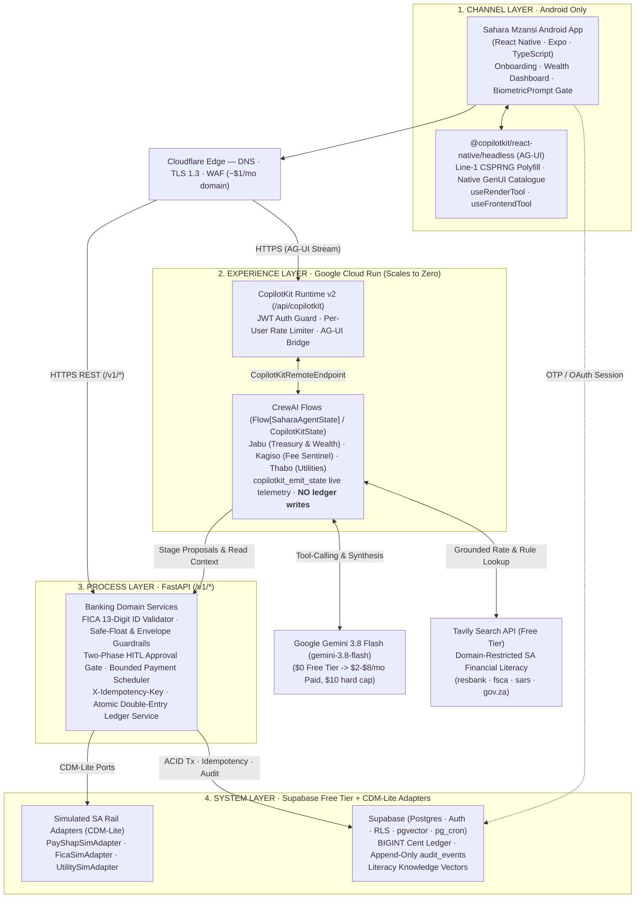

# Sahara Mzansi — High-Level Design (`<= $20/Month` Stack)

The high-level design for **Sahara Mzansi**: a lean, regulated-pattern agentic banking and wealth super app built exclusively for **Android** across four strictly separated layers (**Channel → Experience → Process → System**) under a hard **`<= $20/month`** FinOps ceiling (`~$1–$9/month` actual).

Editable diagrams: [`agentic-demo-hld.drawio`](agentic-demo-hld.drawio) and [`SystemContext.drawio`](SystemContext.drawio).  
Visual UI/UX specification: [`docs/designs/sahara-mzansi/README.md`](../designs/sahara-mzansi/README.md).  
Governing ADRs: [`ADR-001`](../decisions/ADR-001-target-android-only-expo-channel.md) through [`ADR-005`](../decisions/ADR-005-enforce-biometric-hitl-and-twenty-dollar-finops-cap.md).

---

## 1. End-to-End Architecture

---

## 2. Layers and Capabilities

### Channel Layer (`mobile/` — Android Only)
- **Focused Target ([ADR-001](../decisions/ADR-001-target-android-only-expo-channel.md)):** Android smartphones and emulators built with **React Native + Expo**. Web, iOS (`$99/yr`), and secondary mobile app stores are descoped so 100% of effort goes into a crisp native mobile banking UX at `$0` distribution cost (**Firebase App Distribution** + **EAS Free Tier**).
- **Native Agentic Client ([ADR-002](../decisions/ADR-002-adopt-copilotkit-react-native-headless-and-ag-ui.md)):** Uses `@copilotkit/react-native/headless` over **AG-UI**, importing `react-native-get-random-values` on **line 1** of `index.js` before `@copilotkit/react-native/polyfills` so Hermes uses Android's hardware-backed CSPRNG rather than `Math.random`.
- **Native Generative UI & Biometrics:** Renders bespoke **Sahara Mzansi** components (`View`, `Text`, `Pressable`) via `useRenderTool` and gates consequential actions behind Android's `BiometricPrompt` (`expo-local-authentication`).

### Experience Layer (`backend/copilot-runtime/` & `backend/app/agents/`)
- **Self-Hosted Runtime:** `@copilotkit/runtime/v2` verifies the caller's Supabase JWT, enforces per-user daily turn quotas, and bridges AG-UI streams to FastAPI `/copilotkit` (`CopilotKitRemoteEndpoint`).
- **Stateful Multi-Agent Orchestration ([ADR-003](../decisions/ADR-003-orchestrate-agents-with-crewai-flows-gemini-and-tavily.md)):** CrewAI `Flow[SaharaAgentState]` (extending `CopilotKitState`) coordinates:
  - **Jabu:** Recipient & ShapID lookup, PayShap (`R0`) vs EFT RTC fee comparison, safe daily float calculation, high-yield Notice Stash sweeps, and compound-vs-inflation wealth simulations.
  - **Kagiso:** Recurring DebiCheck / subscription fee audits and staged debit-order blocks.
  - **Thabo:** Prepaid electricity/airtime tracking and monthly category budget quotas.
- **Live Telemetry & Grounded Literacy:** Streams step-by-step status pills (`copilotkit_emit_state`) to the phone while grounding SA financial literacy answers in **Supabase `pgvector`** and domain-restricted **Tavily Search** (`resbank.co.za`, `fsca.co.za`, `sars.gov.za`, `gov.za`).

### Process Layer (`backend/app/process/`)
- **Owns All Business Rules:** FICA onboarding validation (13-digit SA ID Luhn & DOB decoding), `@sahara.shap` proxy registration, virtual card freeze/unfreeze, safe-float checks, bounded recurring payment rules, `X-Idempotency-Key` deduplication, and RFC 9457 Problem Details errors.
- **Two-Phase HITL Gate ([ADR-005](../decisions/ADR-005-enforce-biometric-hitl-and-twenty-dollar-finops-cap.md)):** CrewAI tools can only create `PENDING_APPROVAL` rows (`/v1/approvals/stage`). Money moves **only** when the user passes Android `BiometricPrompt` and calls `/v1/approvals/{id}/confirm`.

### System Layer (`backend/app/system/` & `Supabase`)
- **Supabase ([ADR-004](../decisions/ADR-004-use-supabase-postgres-ledger-and-auth.md)):** Managed Postgres storing balances and double-entry `ledger_entries` in **integer cents (`BIGINT`)**, Row-Level Security, append-only `audit_events` (`UPDATE`/`DELETE` revoked), `pgvector` embeddings, and `pg_cron` triggers.
- **CDM-Lite Adapters:** Simulated PayShap, FICA, and prepaid utility adapters isolated behind canonical Python interfaces.

---

## 3. FinOps Budget Summary (`<= $20/Month` Hard Ceiling)

| Concern | Choice | Monthly Cost |
|---|---|---|
| Mobile build & distribution | Expo + EAS Free Tier + Firebase App Distribution (Android APK) | `$0.00` |
| Backend compute | Google Cloud Run (Docker, scales to zero, free tier) | `$0.00` |
| LLM reasoning | Google Gemini 3.8 Flash (`gemini-3.8-flash`, `$10/mo` hard billing cap) | `$0.00 – $8.00` |
| Financial literacy search | Tavily API Researcher Free Tier (`1,000` credits/mo + 24h `pgvector` cache) | `$0.00` |
| Database / Auth / Vector | Supabase Free Tier (Postgres · Auth · RLS · `pgvector` · `pg_cron`) | `$0.00` |
| Edge DNS / TLS / WAF | Cloudflare Free Plan + custom domain | `~$1.00` |
| **Total Monthly Spend** | — | **`~$1.00 – $9.00 / mo`** |

---

## 4. Deliberate Demo Simplifications

- **Simulated Banking Rails:** All accounts, virtual cards (`last4` tokens only), FICA checks, and PayShap settlements are simulated against a real double-entry Postgres ledger — zero real customer funds or raw card PANs are processed.
- **Single-Database ACID over Kafka:** Because all ledger tables live in one Supabase Postgres instance, transfers execute in atomic SQL transactions rather than distributed Kafka sagas.
- **Educational Literacy Framing (FAIS):** Wealth projections and fee coaching are explicitly framed as educational financial literacy simulations rather than licensed investment advice.
