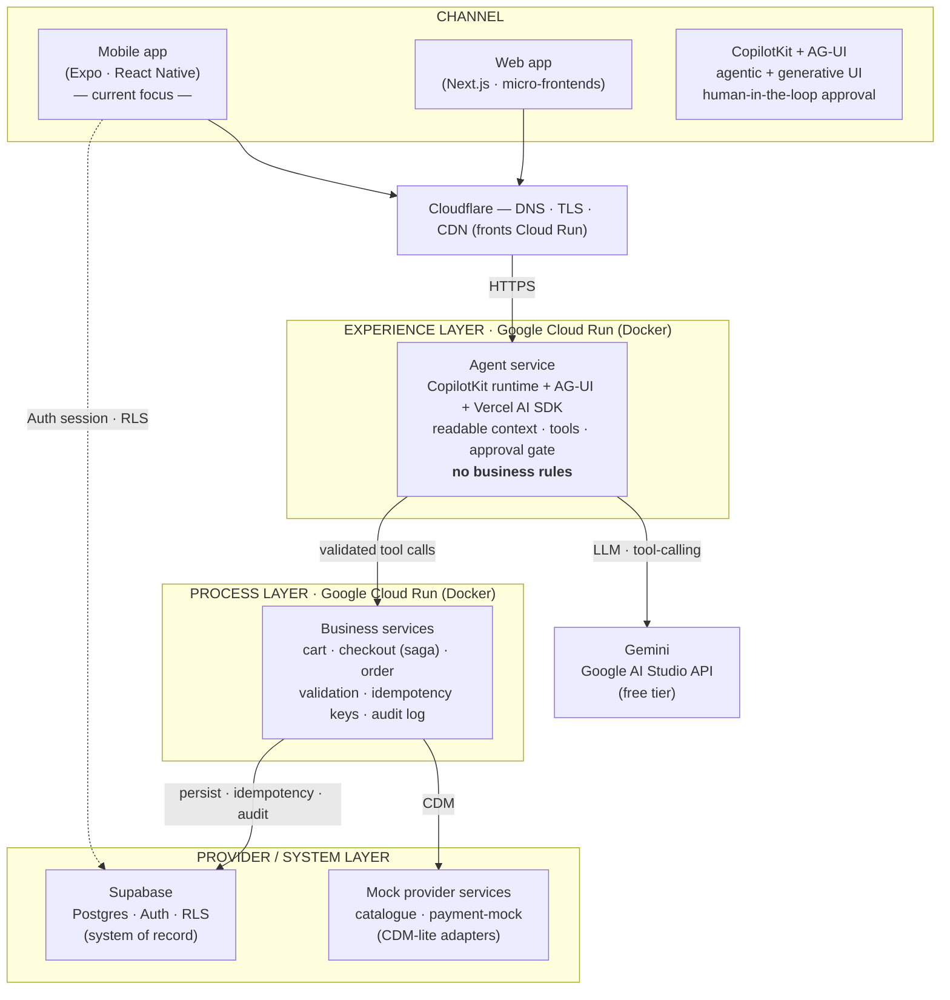

# Agentic Banking Demo — High-Level Design

The high-level design for the reference demo: a simplified, **zero-cost** realisation of
the four-layer banking architecture (**channel → experience → process → provider/system**),
built to *teach the modernization pattern* rather than to be a production banking system.

Editable source: [`agentic-demo-hld.drawio`](agentic-demo-hld.drawio) (open in
[diagrams.net](https://app.diagrams.net) or the VS Code Draw.io extension). The Mermaid
mirror below renders directly on GitHub so teams can read it without any tool.

> **Purpose.** Guide teams who are modernising their architecture and their squads. The
> demo keeps each layer deliberately thin, but the *seams* between layers — and the rules
> at each seam — are the real lesson.

---

## The architecture

---

## Layers and capabilities

### Channel
- **Mobile (React Native via Expo)** — the current focus. Expo gives free cloud builds
  (EAS), free distribution (Android APK via GitHub Releases, iOS via Expo Go), and OTA
  updates — and removes the local full-Xcode requirement.
- **Web (Next.js, micro-frontends)** — a shell composing independently deliverable feature
  frontends, so squads ship slices without a monolith release.
- Both channels use **CopilotKit + AG-UI** for the agentic chat and **generative UI**, and
  both enforce **human-in-the-loop approval** before any consequential action.

### Experience layer — *channel adaptation only, no business rules*
- The **agent service** hosts the CopilotKit runtime, speaks **AG-UI** to the channels, and
  runs the agent loop on the **Vercel AI SDK** with **Gemini**.
- It exposes *readable context* (live app state) and *tools* to the model, and gates
  consequential tools behind approval. It **proposes and presents; it never decides money**.
- Runs as a Docker container on **Google Cloud Run** (scales to zero; free at demo scale).

### Process layer — *business logic lives here*
- **Business services** own cart, checkout (as a small **saga** with declared
  compensation), and order. They perform validation, enforce **idempotency keys** on every
  write, and emit an **audit log** entry per state change.
- This is where teams see the modernization discipline: the agent cannot write directly;
  every mutation is a validated, idempotent, audited call into this layer.

### Provider / System layer — *systems of record behind thin adapters*
- **Mock provider services** (catalogue, payment-mock) stand in for bounded-context
  providers, each behind a **CDM-lite adapter** so the canonical model is visible even in
  the demo.
- **Supabase** (Postgres + Auth + Row-Level Security) is the system of record. Supabase
  Auth provides real identity; RLS is the data-access guard. The service-role key stays
  backend-only; the app uses the anon key plus the user's session.

### Edge & cross-cutting
- **Cloudflare** provides DNS, TLS, and CDN on a custom domain in front of Cloud Run (the
  one planned spend is the domain).
- **Audit trail** is emitted at every state change in the Process layer — the demo-scale
  stand-in for the regulatory audit requirement.

---

## The zero-cost stack at a glance

| Concern | Choice | Cost |
|---|---|---|
| LLM | Gemini (Google AI Studio API, free tier) | Free |
| Agent runtime | Vercel AI SDK + CopilotKit / AG-UI | Free (OSS) |
| Backend hosting | Google Cloud Run (Docker, scales to zero) | Free at demo scale |
| Database / Auth | Supabase free tier (Postgres · Auth · RLS) | Free |
| Edge / domain | Cloudflare (free plan) + custom domain | ~domain only |
| Mobile build/dist | Expo + EAS; Android APK via GitHub Releases; iOS via Expo Go | Free* |

\* True iOS TestFlight / ad-hoc distribution needs an Apple Developer account ($99/yr); every
other path here is free.

---

## What this demo deliberately simplifies

Honest scope, so adopters know where the edges are:

- **One agent, mock providers.** No real core banking, no real payments, no Kafka/ESB.
- **CDM-lite.** The canonical model is illustrated, not fully governed by a schema registry.
- **Saga, lightly.** Checkout shows the orchestration + compensation shape without a
  distributed-transaction engine.
- **Security posture is demonstrated, not hardened.** OAuth/PKCE and mTLS are design intent
  (see the [integration pillar](integration-architecture.md)); the demo stubs where a real
  system would enforce.

For the full-scale target these simplifications map onto, see the
[integration architecture pillar](integration-architecture.md) and the encoded
[senior-engineering-lead agent](../../.github/agents/senior-engineering-lead.agent.md).

---

## Open decisions

Tracked as `Q1`–`Q11` in the [workshop notes](agentic-app-workshop-notes.md); the ones that
most affect this HLD:

- Streaming transport between the agent service and the RN app (AG-UI over SSE / WebSocket).
- The versioned **native component-catalogue contract** for mobile generative UI.
- Which writes require explicit approval (order only, or cart changes too).

These will be recorded as ADRs in [`docs/decisions/`](../decisions/ADR-000-index.md).
