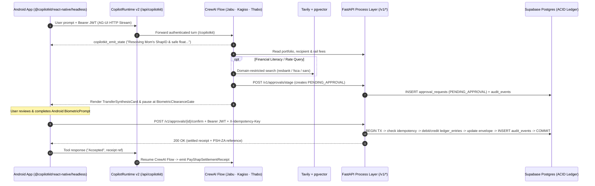

# Integration & Agentic Backend Architecture

**Pillar page — one of two equal pillars in this standard. See also [Mobile Channel & Agentic UI Architecture](frontend-architecture.md).**

This page defines how the Android client, the **CopilotKit + CrewAI** Experience layer, the **FastAPI** Process layer, and the **Supabase + Simulated Rail** System layer integrate cleanly without enterprise middleware sprawl — staying strictly inside our **`<= $20/month`** FinOps ceiling.

Governing ADRs: [ADR-002](../decisions/ADR-002-adopt-copilotkit-react-native-headless-and-ag-ui.md), [ADR-003](../decisions/ADR-003-orchestrate-agents-with-crewai-flows-gemini-and-tavily.md), [ADR-004](../decisions/ADR-004-use-supabase-postgres-ledger-and-auth.md), [ADR-005](../decisions/ADR-005-enforce-biometric-hitl-and-twenty-dollar-finops-cap.md).

---

## 1. Architectural Principles

1. **Strict Layer Separation Without Microservice Sprawl:** Experience, Process, and System responsibilities are strictly separated by module boundaries, never collapsed into client code or bloated into multi-language Kubernetes/Kafka clusters.
2. **Canonical Data Model (CDM-Lite) at Adapter Seams:** All monetary amounts use integer cents (`BIGINT` / `amount_cents: int`), and simulated external rails (`PayShap`, `FICA`, `Utilities`) sit behind clean adapter interfaces.
3. **Single-Database ACID Ledger Integrity:** Because accounts, vaults, staged approvals, idempotency keys, and audit logs live in one Supabase Postgres database, transfers execute inside a single `SERIALIZABLE` / `FOR UPDATE` SQL transaction — eliminating distributed saga drift.
4. **Two-Phase Agentic & Biometric HITL Chain:** CrewAI agents can **propose and stage** (`PENDING_APPROVAL`), never execute. Only a biometric-verified user request to `/v1/approvals/{id}/confirm` commits ledger entries.
5. **Grounded Financial Intelligence:** Rates, tax-free thresholds, and fee rules are retrieved from `pgvector` and domain-restricted **Tavily Search** (`resbank.co.za`, `fsca.co.za`, `sars.gov.za`, `gov.za`), cached for 24 hours to preserve free-tier quotas.

---

## 2. Responsibility Matrix Across Layers

| Layer | Runtime / Location | Owns | Forbidden Here |
|---|---|---|---|
| **Experience** | `backend/copilot-runtime/` (Node 22) + `backend/app/agents/` (Python CrewAI) | AG-UI streaming, JWT verification, rate limiting, `Flow[SaharaAgentState]` (`CopilotKitState`), `copilotkit_emit_state` progress pills, Tavily + `pgvector` literacy retrieval | Direct SQL ledger writes, floating-point currency math, bypassing HITL approval |
| **Process** | `backend/app/process/` (`FastAPI` `/v1/*`) | FICA 13-digit SA ID validation, safe-float & budget checks, staged approvals, `X-Idempotency-Key` deduplication, bounded recurring schedules, double-entry ledger commits | React Native layout logic, raw third-party wire schemas |
| **System** | `backend/app/system/` + `Supabase` | Postgres schema + RLS, `Supabase Auth`, `pgvector`, `pg_cron`, append-only `audit_events`, CDM-lite simulated rail adapters | Multi-step workflow orchestration, UI formatting |

---

## 3. Dual Communication Paths: AG-UI Stream + REST Process API



### Why Two Paths Work Together Cleanly
- **AG-UI Stream (`/api/copilotkit` $\rightarrow$ `/copilotkit`):** Carries natural-language turns, `CopilotKitState` progress updates (`logs`, `canvas_logs`), and generative UI tool calls (`useRenderTool`).
- **REST Process API (`/v1/*`):** Serves deterministic reads (dashboard hydration, FICA onboarding) and **biometric-confirmed mutations** (`/v1/approvals/{id}/confirm`) where standard HTTP status codes, RFC 9457 Problem Details, and `X-Idempotency-Key` headers provide rock-solid auditability.

---

## 4. CrewAI `CopilotKitState` Design

Extending `CopilotKitState` allows the Python backend to stream structured state directly into the Android app before, during, and after tool execution:

```python
from typing import Any, Dict, List, Optional
from copilotkit.crewai import CopilotKitState


class SaharaAgentState(CopilotKitState):
    """Shared state streamed between CrewAI Flows and the Android AG-UI client."""
    active_agent: str = "jabu"  # jabu | kagiso | thabo
    logs: List[Dict[str, str]] = []
    canvas_logs: Dict[str, str] = {"title": "", "subtitle": ""}
    staged_approval: Optional[Dict[str, Any]] = None
    literacy_sources: List[Dict[str, str]] = []
```

Each Flow step updates `self.state.canvas_logs` and awaits `copilotkit_emit_state(self.state)` so the user sees transparent, calm telemetry (*"Comparing PayShap R0 rail vs EFT RTC..."*) rather than an opaque spinner.

---

## 5. The 6-Step Agentic & Biometric Authorization Chain

Every state-changing financial operation must pass all six checks in `backend/app/process/` in order:

```
1. Supabase JWT Verification (valid session, matching user_id)
2. Domain & Guardrail Validation (FICA active, safe float respected, envelope/mandate caps checked)
3. Human-in-the-Loop Clearance Check (approval_requests row exists, unexpired, confirmed by user)
4. Idempotency Deduplication (X-Idempotency-Key checked in idempotency_keys)
5. Atomic Double-Entry Ledger Execution (balanced debit + credit in BIGINT cents)
6. Append-Only Audit Event (immutable row with before/after state SHA-256 hashes)
```

---

## 6. Bounded Payment Automation (`pg_cron` + Safe-Float Pre-Check)

Users can ask *Jabu* (or tap Screen 8's **Automate Monthly** button) to create a recurring rule (e.g., *"Send R1,500 to Mom every 25th"* or *"Sweep idle cash above R10,000 into my 8.25% Notice Stash"*):
1. Creating the rule itself requires a **Screen 7 Biometric HITL confirmation** locking the recipient, ceiling (`<= R2,000/mo`), and schedule.
2. When `pg_cron` triggers a due rule, the Process layer runs **safe-float and balance pre-checks** first.
3. For demo transparency and safety, scheduled runs stage a ready-to-approve clearance card (or execute strictly within an explicit user-signed micro-mandate ceiling) and remain **1-tap revocable** from the Dashboard at any time.
